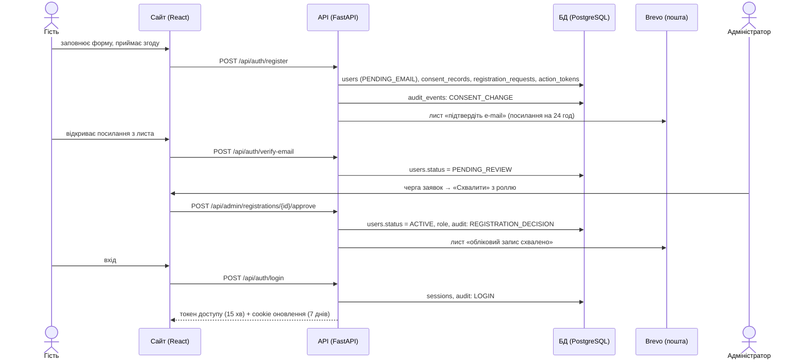

# 1. Реєстрація, підтвердження e-mail, вхід і сесії

**Вимоги:** FR-01 – FR-05, FR-34, FR-42 · **Прецеденти:** UC-01, UC-02, UC-03, UC-21 · **Правила:** DG-09, DG-10, D-01 ·
**NFR:** NFR-14 (паролі), NFR-15 (сесії), NFR-16 (права на сервері), NFR-18 (ліміт запитів), NFR-19 (файли).

**Код:** `backend/app/api/auth.py`, `admin.py`, `me.py`; `backend/app/core/security.py`, `deps.py`, `audit.py`, `mail.py`;
сторінки `frontend/src/pages/RegisterPage.tsx`, `TokenPages.tsx`, `LoginPage.tsx`, `AdminRegistrationsPage.tsx`, `ProfilePage.tsx`.
**Тести:** `backend/tests/test_identity.py` (22), `frontend/src/lib/session.test.ts`.

## Загальна схема

## Крок 1. Форма реєстрації (`/register`)
Сторінка завантажує три довідники без входу: `GET /api/countries`, `GET /api/organizations` (лише верифіковані:
id, назва, тип, країна — без доменів e-mail), `GET /api/auth/consent` (чинний текст згоди, версія 1.0).

Користувач вводить ПІБ, e-mail, пароль (двічі), країну, тип облікового запису, мету; для «представника організації» —
організацію зі списку або назву нової й за потреби документ; ставить **окрему галочку згоди** (DG-09).

## Крок 2. Перевірки на сервері (`POST /api/auth/register`, multipart)
Порядок — від найдешевших до найдорожчих:

| №   | Перевірка                                                                                           | Помилка                                               |
| --- | --------------------------------------------------------------------------------------------------- | ----------------------------------------------------- |
| 1   | ліміт: 5 реєстрацій за хвилину з однієї IP-адреси (IP — з заголовка `x-vercel-forwarded-for`, S-07) | 429 `RATE_LIMITED`                                    |
| 2   | галочка згоди стоїть                                                                                | 400 `CONSENT_REQUIRED`                                |
| 3   | версія тексту згоди = чинна (текст не змінився, поки користувач заповнював форму)                   | 400 `CONSENT_VERSION_OUTDATED`                        |
| 4   | формат e-mail, код країни ISO 3166-1 alpha-3                                                        | 422 `INVALID_EMAIL`, `INVALID_COUNTRY_CODE`           |
| 5   | пароль: ≥ 10 символів, є літери й цифри (NFR-14)                                                    | 422 `WEAK_PASSWORD` + перелік проблем                 |
| 6   | документ (якщо є): ≤ 2 МБ; тип **за вмістом** (сигнатура PDF / PNG / JPEG), а не за назвою          | 413, 415 `UNSUPPORTED_FILE_TYPE`                      |
| 7   | представник організації: обрана організація існує й верифікована, або вказано назву нової           | 422 `ORGANIZATION_NOT_FOUND`, `ORGANIZATION_REQUIRED` |
| 8   | представник: e-mail на домені організації **або** документ (UC-01 AC1)                              | 422 `VERIFICATION_DOCUMENT_REQUIRED`                  |

**Якщо e-mail уже зареєстровано** (без урахування регістру): відповідь та сама — 202 «перевірте пошту»,
а власнику адреси йде лист «хтось спробував зареєструватися з вашою адресою». Так за відповіддю не можна дізнатися,
чи існує обліковий запис (UC-01 EX1).

## Крок 3. Що записується в БД (одна транзакція)
| Таблиця | Що | Деталі |
|---|---|---|
| `users` | новий користувач | статус `PENDING_EMAIL`, роль `ANALYST`; **пароль — лише хеш Argon2id** (19 МіБ пам'яті, 2 проходи, ~35 мс) |
| `consent_records` | запис згоди | `GIVEN`, версія 1.0, час, IP-адреса; змінити запис неможливо — тригер БД (DG-10) |
| `stored_files` | документ (якщо є) | байти в БД поза публічним каталогом, SHA-256; видаляється через 30 днів після рішення адміністратора (табл. 3.26) |
| `registration_requests` | заявка | `PENDING`, мета, вказана організація |
| `action_tokens` | токен підтвердження e-mail | у БД **лише SHA-256 токена**, сам токен — тільки в листі; дійсний 24 год |
| `audit_events` | `CONSENT_CHANGE` | хто й яку версію згоди прийняв (без ПІБ, e-mail, IP) |

Після COMMIT надсилається лист (Brevo): `https://gedh.vercel.app/verify-email?token=…`.
Якщо пошта не спрацювала, реєстрація все одно збережена; повторний лист — `POST /api/auth/resend-verification`.

## Крок 4. Підтвердження e-mail (`/verify-email?token=…`)
`POST /api/auth/verify-email`: сервер рахує SHA-256 отриманого токена і шукає його в `action_tokens`.
- не знайдено або вже використано → 400 `TOKEN_INVALID`;
- минуло 24 год → 410 `TOKEN_EXPIRED` (сторінка пропонує надіслати новий лист);
- інакше: токен позначається використаним, статус користувача `PENDING_EMAIL` → `PENDING_REVIEW`.
**Лише тепер** заявка з'являється в черзі адміністратора (FR-02).

## Крок 5. Розгляд адміністратором (`/admin/registrations`) — детально у файлі 4
- **Схвалити** з роллю: Аналітик / Представник організації / Постачальник даних; для двох останніх — верифікована організація (FR-04).
- **Відхилити** — лише з причиною (≥ 5 символів).
- **Запитати уточнення** — заявник отримує одноразове посилання (7 днів) на сторінку відповіді без входу (UC-02 AC1).
- **Власну заявку розглянути не можна** — 403 `SELF_REVIEW_FORBIDDEN` (D-01).

## Крок 6. Вхід (`/login` → `POST /api/auth/login`)
| № | Що відбувається |
|---|---|
| 1 | ліміт: 10 спроб за хвилину з IP (NFR-18) → 429 |
| 2 | якщо обліковий запис заблоковано (5 невдач поспіль) — 423 `ACCOUNT_LOCKED` і скільки чекати (15 хв) |
| 3 | перевірка пароля Argon2id. Для **невідомого** e-mail перевіряється «порожній» хеш — час відповіді однаковий |
| 4 | невдача: +1 до лічильника в БД, запис `LOGIN_FAILED / DENIED` у журнал, відповідь **однакова** для «немає e-mail» і «невірний пароль» — 401 `INVALID_CREDENTIALS` |
| 5 | пароль правильний, але статус не `ACTIVE` — 403 `ACCOUNT_NOT_ACTIVE` зі статусом (очікує підтвердження / розгляду / відхилено / деактивовано) |
| 6 | успіх: лічильник обнуляється; створюється запис у `sessions` (зберігається **SHA-256** токена оновлення); журнал `LOGIN` |

**Що отримує браузер:**
- **токен доступу** JWT (HS256, 15 хв) — у тілі відповіді; містить id користувача, роль і id сесії; зберігається **лише в пам'яті сторінки** (не в localStorage — його не вкраде сторонній скрипт);
- cookie **`gedh_refresh`** — токен оновлення, 7 днів: `HttpOnly` (JavaScript не бачить), `Secure`, `SameSite=Lax`, `Path=/api/auth`;
- cookie **`gedh_csrf`** — випадкове значення для захисту від CSRF (читається JavaScript).

Після входу кожна роль потрапляє на свою сторінку: адміністратор — заявки, постачальник — «Мої набори»,
DG-офіцер — «Перевірка наборів», решта — «Дані».

## Крок 7. Кожен наступний запит
`Authorization: Bearer <токен>` → `backend/app/core/deps.py`:
1. підпис і строк токена (інакше 401 `TOKEN_EXPIRED`);
2. користувач і сесія існують, сесію не відкликано (інакше 401 `SESSION_REVOKED`);
3. **статус `ACTIVE` і роль беруться з БД**, не з токена — деактивація й зміна ролі діють одразу (NFR-16);
4. для захищених маршрутів — перевірка ролі; чужа роль → 403 `FORBIDDEN_ROLE` **і запис `SECURITY_INCIDENT / DENIED` у журнал**.

## Крок 8. Оновлення сесії й вихід
- Через 15 хв API відповідає 401 → браузер викликає `POST /api/auth/refresh` з заголовком `X-CSRF-Token`
  = значення cookie `gedh_csrf` (подвійне подання) і перевіркою `Origin`. **Ротація:** старий токен оновлення
  відкликається, видається новий; повторне використання старого → 401. Кілька одночасних 401 запускають **одне**
  оновлення (`frontend/src/lib/session.ts`).
- Після перезавантаження сторінки токена в пам'яті немає — сесія відновлюється так само, за cookie.
- **Вихід** — `POST /api/auth/logout`: сесія відкликається, cookie видаляються, кеш відповідей у браузері очищається.

## Крок 9. Профіль і права суб'єкта ПД (`/profile`, UC-21)
- `GET /api/me` — дані користувача, прийнята версія згоди й **таблиця «що зберігається, навіщо й скільки»** (табл. 3.26).
- `PATCH /api/me` — ПІБ і посада; у журнал (`CONFIG_CHANGE`) пишуться **лише назви змінених полів**, не значення.
- Нова версія згоди — після входу модальне вікно (UC-03 AC2) → `POST /api/me/consent`.
- **Видалення або відкликання згоди** — `POST /api/me/delete` з паролем і галочкою «видалив дані за дозволами» (DG-12).
  В одній транзакції: чинні дозволи завершуються з датою підтвердження видалення, сесії відкликаються, статус
  `DEACTIVATED`; при відкликанні згоди — запис `WITHDRAWN`. Анонімізація — через 30 днів щоденною задачею (DG-24, файл 8, крок 4).
  Постачальник, на набори якого є чинні дозволи, а іншого постачальника в організації немає — 409 (UC-21 EX2).
