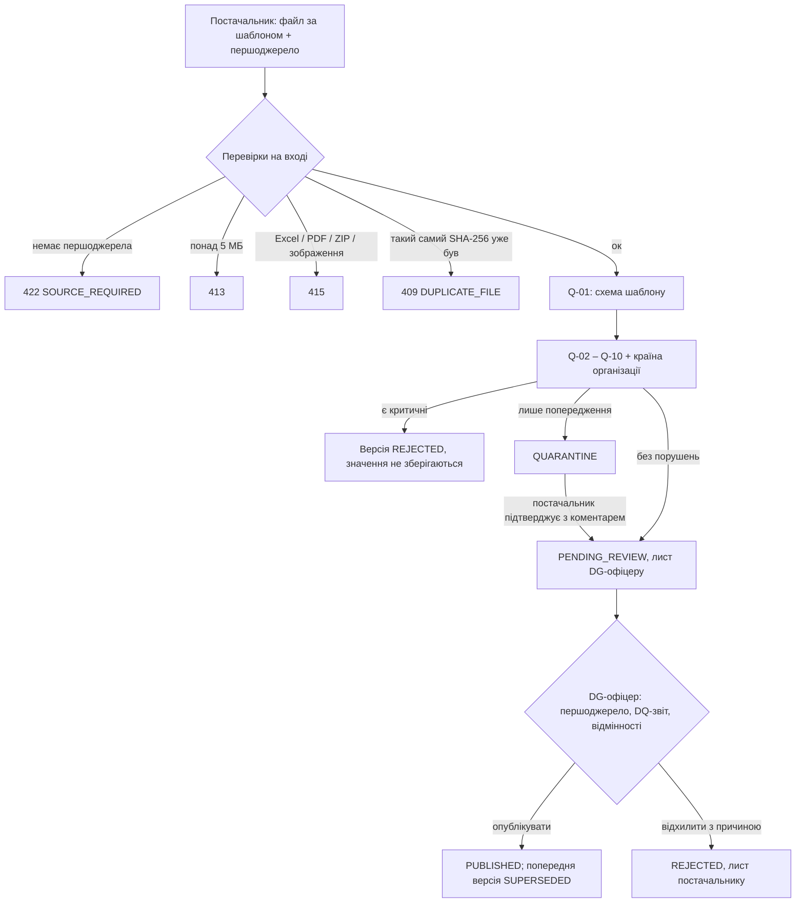

# 3. Завантаження закритого набору постачальником і перевірки якості

**Вимоги:** FR-16, FR-21, FR-22, FR-23 · **Прецеденти:** UC-12, UC-13, UC-18 · **Правила:** DG-04, DG-06, DG-16, DG-20, DG-21 ·
**NFR:** NFR-19 (файли). Правила якості Q-01 – Q-11 — табл. 3.31 звіту.

**Код:** `backend/app/api/uploads.py`, `backend/app/ingestion/upload.py` (шаблон і розбір),
`backend/app/ingestion/quality.py` (правила якості); сторінки `frontend/src/pages/DatasetPages.tsx`.
**Тести:** `backend/tests/test_uploads.py` (15).

## Ідея одним реченням
Стандартизація відбувається **на вході й силами постачальника**: платформа приймає лише файл за власним шаблоном
з кодами своїх довідників. Автоматика перевіряє **форму й правдоподібність**, DG-офіцер — **джерело й довіру**.
Після публікації закриті дані зберігаються в тому самому вигляді, що й відкриті.

## Схема



## Крок 0. Що стандартизовано заздалегідь
| Довідник | Приклад | Де |
|---|---|---|
| Країни (ISO 3166-1 alpha-3) | `UKR`, `POL` | таблиця `countries` |
| Показники: код, одиниця, масштаб, частота, діапазони Q-06 / Q-07 | `WAGE_REGION`: USD, квартальний, можливо 0–100 000, типово 100–10 000 | `indicators` |
| Категорії закритих даних | `PRICES`, `LABOUR`, `TRADE`… | `data_categories` |
| Шаблон | 6 колонок, однакові для всіх країн | `GET /api/templates/upload.csv`, `upload.schema.json` |

Новий вид даних (новий показник) спершу додає адміністратор у довідник — тоді його можна завантажувати.

## Крок 1. Постачальник готує файл
Його внутрішня таблиця («широка», зі своїми назвами й одиницями) перетворюється на «довгий» формат шаблону —
одне значення в рядку, коди з довідників:

```
country,indicator,breakdown,period,value,note
UKR,WAGE_REGION,Київ,2026-Q2,620,
UKR,WAGE_REGION,Львів,2026-Q2,,дані не зібрано
```

| Колонка | Правило |
|---|---|
| `country` | код країни; **має збігатися з країною організації постачальника** |
| `indicator` | код показника з довідника |
| `breakdown` | розріз: регіон, місто, країна-партнер, кредитор (необов'язково) |
| `period` | ISO 8601 за частотою показника: рік `2026`, квартал `2026-Q2`, місяць `2026-03` |
| `value` | число; порожньо — лише з поясненням у `note` |
| `note` | примітка (необов'язково) |

JSON — той самий зміст: `{"observations": [{"country": "UKR", "indicator": "WAGE_REGION", ...}]}`.
**CSV і JSON перевіряються однією JSON Schema**, тож правила однакові.

## Крок 2. Форма (`/provider` → «Завантажити набір»)
Набір: новий (категорія, назви UA / EN) або нова версія наявного. Файл. **Першоджерело:** назва документа, номер,
дата, посилання, внутрішній реєстраційний номер, методика, відповідальна особа.

## Крок 3. Перевірки на вході (`POST /api/provider/uploads`) — до читання вмісту
| № | Перевірка | Помилка |
|---|---|---|
| 1 | роль «Постачальник даних», є організація | 403 |
| 2 | **першоджерело (Q-11):** назва, методика, відповідальна особа **і** хоча б один ідентифікатор — номер з датою, посилання або внутрішній номер | 422 `SOURCE_REQUIRED` |
| 3 | розмір ≤ 5 МБ | 413 `FILE_TOO_LARGE` |
| 4 | тип **за вмістом**: сигнатури Excel / ZIP / PDF / PNG / JPEG / GIF відсікаються | 415 `UNSUPPORTED_FILE_TYPE` |
| 5 | **SHA-256 файлу** — такий файл уже завантажували? | 409 `DUPLICATE_FILE` |
| 6 | нова версія — лише набору **своєї** організації, не відкликаного | 403 / 409 |

## Крок 4. Структура — Q-01 (`backend/app/ingestion/upload.py`)
Кодування UTF-8 (BOM від Excel допускається); JSON читається; заголовок CSV — рівно 6 колонок; кожен рядок
відповідає JSON Schema (типи, формат коду країни й періоду). Файл, що не читається, — одна критична помилка
без подальших перевірок (UC-18 EX1). Звіт показує **номер рядка й поле**.

## Крок 5. Зміст — правила якості (`backend/app/ingestion/quality.py`)
| Правило | Що перевіряє | Приклад порушення | Рівень |
|---|---|---|---|
| Q-02 Повнота | є країна, показник, період; значення або примітка | порожнє значення без пояснення | критичне |
| Q-03 Узгодженість | коди є в довідниках; **країна = країна організації** | `POL` у файлі українського агентства | критичне |
| Q-04 Коректність періоду | період відповідає частоті показника | `2026` для квартального показника | критичне |
| Q-05 Унікальність | одне значення на «країна × показник × розріз × період» | Київ, II кв. двічі | критичне |
| Q-06 Можливий діапазон | значення фізично можливе | зарплата −50 | критичне |
| Q-07 Типовий діапазон | значення правдоподібне | зарплата 25 000 | попередження |
| Q-08 Перегляд | зміна відносно чинної версії ≤ 20 % | було 620, стало 900 | попередження |
| Q-09 Пропуски | пропущено ≤ 30 % періодів ряду | 2 квартали з 8 | попередження |
| Q-10 Актуальність | останнє значення не старше двох періодів частоти | квартальний ряд закінчується торік | попередження |

**DQ-score** = 100 × (рядки без порушень + 0,5 × рядки лише з попередженнями) / усі рядки файлу; завжди 0–100
(це додатково гарантує обмеження CHECK у БД).

## Крок 6. Вердикт системи й що зберігається
| Результат | Статус версії | Що далі |
|---|---|---|
| є критичне | `REJECTED` | значення **не** зберігаються; файл — 30 днів (табл. 3.26); постачальник виправляє й завантажує знову |
| лише попередження | `QUARANTINE` | постачальник відкриває версію в таблиці й **підтверджує з коментарем** → `PENDING_REVIEW` (коментар — у журналі) |
| без порушень | `PENDING_REVIEW` | лист DG-офіцерам |

| Таблиця | Що |
|---|---|
| `datasets` | закритий набір (`kind = RESTRICTED`): країна організації, категорія, власник; **клас RESTRICTED змінити неможливо** — тригер БД (DG-02); на демо **завжди `is_synthetic = true`** (D-04) |
| `dataset_versions` | номер версії, статус, **SHA-256 файлу**, хто завантажив |
| `source_references` | першоджерело — окремо для кожної версії |
| `stored_files` | сам файл (доказ походження) |
| `observations` | значення (крім відхилених версій) |
| `quality_reports`, `quality_issues` | DQ-звіт і кожне порушення з рядком |
| `audit_events` | `DATASET_UPLOAD`: набір, версія, статус, SHA-256, кількість рядків, DQ-score |

## Крок 7. Перевірка DG-офіцером (`/dg/review`)
DG-офіцер бачить **першоджерело**, **DQ-звіт** і **відмінності від попередньої опублікованої версії**
(додано / змінено / вилучено значень). Перевіряє, чи документ існує й відповідає даним, чи методика підходить
показнику, чи вказано реальну відповідальну особу, чи переконливий коментар до попереджень.
- **Опублікувати** (`POST /api/dataset-versions/{id}/publish`): статус `PUBLISHED`; попередня версія — `SUPERSEDED`
  (**не змінюється й не видаляється**, D-05), зв'язок `previous_id` — це lineage; набір `DRAFT` → `ACTIVE`;
  журнал `DATASET_PUBLISH`; лист постачальнику.
- **Відхилити з причиною** (`.../reject`): `REJECTED`, файл — 30 днів, журнал `DATASET_REJECT`, лист постачальнику.
- Опублікувати **власне** завантаження не можна — 403 (D-01).

## Крок 8. Після публікації
Набір у каталозі з позначками «доступ за заявкою» і «СИНТЕТИЧНІ ДАНІ». Значення бачать лише організація-власник
і DG-офіцер; іншим — тільки через заявку й дозвіл (Е4). Постачальник у «Мої набори» може відкрити будь-яку версію
й побачити її звіт і причину відхилення.
