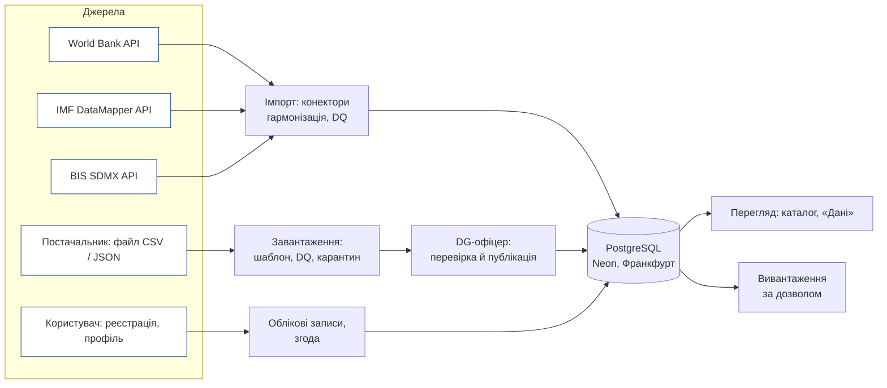

# 5. Потік даних: звідки приходять, де лежать, куди йдуть

**Вимоги:** FR-14 – FR-16, FR-21 – FR-23, FR-30 · **Прецеденти:** UC-12 – UC-14, UC-17, UC-18 ·
**Правила:** DG-05, DG-16 – DG-22, D-05 · **Звіт:** DFD рівня 0 (рис. 3.5), реєстр даних (табл. 3.26).

## Три канали надходження даних

## Канал 1. Відкриті дані — автоматичний імпорт (UC-14)
**Код:** `backend/app/ingestion/sources.py`, `service.py`; `.github/workflows/import.yml`; `backend/app/api/jobs.py`.

| № | Крок | Деталі |
|---|---|---|
| 1 | **Запуск** | щодня о 03:00 UTC GitHub Actions викликає планувальник, і запускаються конектори, чий розклад (cron) припадає на цей день — типово щопонеділка (S-37); вручну — кнопка «Запустити» на сторінці «Конектори» (файл 12) або Actions → «Import open data» → Run workflow. Workflow спершу «будить» Render (повторює `/api/health`, поки сервер не відповість), потім `POST /api/internal/jobs/import` із секретом `X-Job-Token`. API одразу відповідає 202 і працює у фоні |
| 2 | **10 конекторів**, по одному на показник | 7 — World Bank, 2 — IMF, 1 — BIS; запит одразу для 25 країн |
| 3 | **Повторні спроби** | якщо джерело не відповідає — ще 3 спроби з паузами 2, 4, 8 с; потім запуск `FAILED`, **наявні дані не змінюються** (NFR-11) |
| 4 | **Сира відповідь** | зберігається стиснутою (gzip) у `raw_payloads` з **SHA-256** — 90 днів (табл. 3.26); можна довести, що саме прислало джерело |
| 5 | **Гармонізація** (FR-15) | коди країн ISO alpha-3; ВВП → млрд USD; IMF — лише роки до поточного − 1 (без прогнозів), останній — «оцінка IMF WEO»; BIS — щомісячна ставка → грудень = річне значення; єврозона — ряд XM (ставка ЄЦБ) з приміткою; UA, EG — немає (D-37) |
| 6 | **Перевірка якості** Q-02 – Q-10 | критичні → запуск `REJECTED_BY_DQ`, нової версії немає; **попередження не блокують** відкриті дані (DG-22), а зберігаються у звіті |
| 7 | **Версія лише за зміни** (FR-16) | порівнюється з чинною версією; ті самі значення → нової версії немає. Інакше — нова версія (повний знімок, `PUBLISHED`), попередня → `SUPERSEDED`, зв'язок `previous_id` |
| 8 | **Журнал** | `DATASET_PUBLISH` з джерелом, показником, кількістю записів, DQ-score, номером версії, SHA-256 сирої відповіді |

## Канал 2. Закриті дані — від постачальника (UC-12, UC-13)
Детально — у файлі 3. Коротко: шаблон → першоджерело → перевірки на вході → Q-01 – Q-11 → карантин / DG-офіцер →
публікація. На відміну від відкритих даних, **без людської перевірки (DG-офіцер) закрита версія не публікується**.

## Канал 3. Персональні дані користувачів (UC-01, UC-21)
Детально — у файлі 1. Персональні дані **не виходять за межі платформи**: поштовий сервіс Brevo отримує лише адресу
й текст сповіщення (DG-25). У журнал аудиту ПІБ, e-mail і IP не пишуться.

## Вихід даних — лише через перевірку доступу
Відкриті дані — будь-якому активному обліковому запису; закриті — лише в межах чинного дозволу, з перевіркою
на кожному запиті й записом кожного перегляду та вивантаження в журнал. Детально — у файлі 7.

## Де що лежить і скільки (табл. 3.26 звіту)
| Дані | Таблиці | Скільки зберігаються |
|---|---|---|
| облікові записи | `users`, `organizations`, `registration_requests`, `sessions` | поки обліковий запис активний + 30 днів, потім анонімізація (задача — Е5) |
| згода | `consent_records` (лише додавання — тригер БД) | строк облікового запису + 3 роки |
| документи верифікації | `stored_files` | до рішення адміністратора + 30 днів |
| відкриті показники | `datasets` (OPEN), `dataset_versions`, `observations` | безстроково, з історією версій |
| сирі відповіді API | `raw_payloads` | 90 днів |
| закриті набори | `datasets` (RESTRICTED), `dataset_versions`, `observations`, `source_references`, `stored_files` | поки набір активний; відхилені файли — 30 днів |
| звіти якості | `quality_reports`, `quality_issues` | разом із версією |
| журнал аудиту | `audit_events`, `audit_trail` | 3 роки |

## Усі хеші на платформі — навіщо кожен
| Що хешується | Алгоритм | Навіщо |
|---|---|---|
| пароль | **Argon2id** (19 МіБ, 2 проходи, сіль) | пароль неможливо відновити навіть із копії БД (NFR-14) |
| токен з листа (підтвердження e-mail, уточнення) | SHA-256 | у БД немає самого токена — витік БД не дає перейти за посиланням |
| токен оновлення сесії | SHA-256 | те саме для cookie сесії |
| файл постачальника | SHA-256 | доказ, який саме файл завантажено; захист від повторного завантаження (UC-12 EX3) |
| сира відповідь API | SHA-256 | доказ, що саме прислало джерело (lineage) |
| версія відкритого набору | SHA-256 від упорядкованих значень | відбиток вмісту версії |
| журнал аудиту | SHA-256 від запису + хеш попереднього запису | **ланцюжок**: змінити чи видалити запис непомітно неможливо — `verify_chain()` знайде перший зламаний (DG-19) |
| текст угоди | SHA-256 | доказ, з яким саме текстом погодився заявник (DG-11) |

## Журнал аудиту — як записується подія (UC-17)
Код: `backend/app/core/audit.py`. Подія пишеться **в тій самій транзакції**, що й дія (NFR-12): якщо запис у журнал
не вдався, скасовується все. Наприкінці операції сервер блокує рядок `audit_trail` (останній номер і хеш),
рахує хеш нового запису від його вмісту й попереднього хешу, додає запис і оновлює `audit_trail` — паралельні події
не розгалужують ланцюжок (D-40). Перегляд журналу DG-офіцером і заборона змін на рівні ролі й тригерів БД — файл 8.
