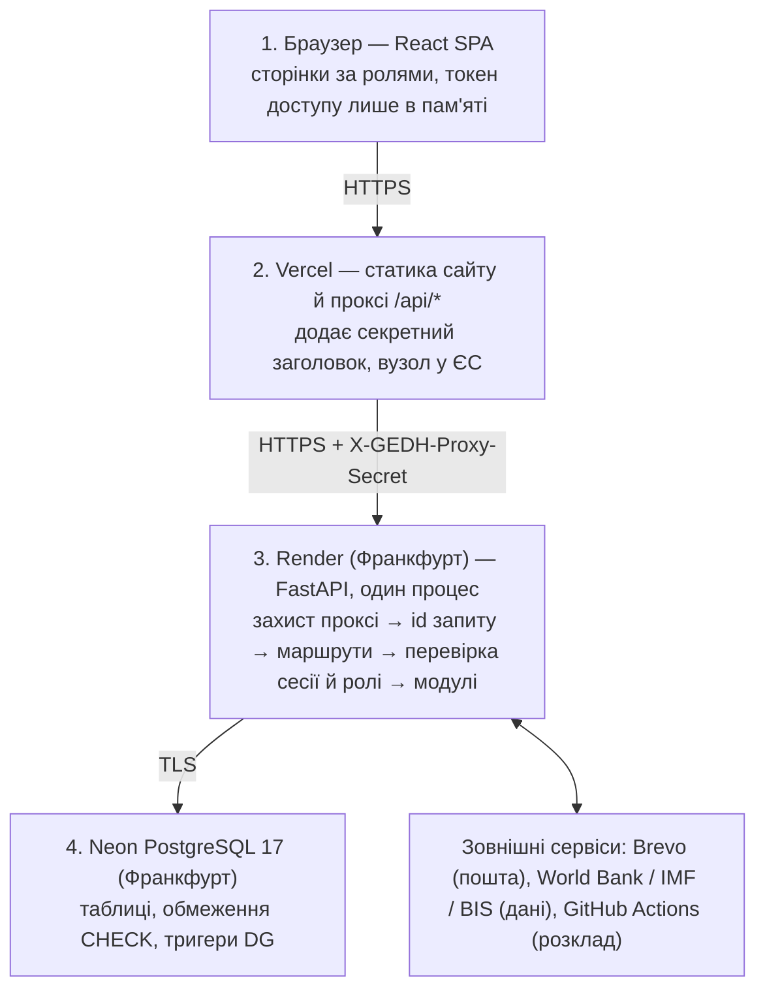

# 6. Архітектура й рівні доступу — від браузера до бази даних

**Звіт:** п. 5.3 (стек, компоненти, розгортання — рис. 5.14, 5.15), табл. 5.5 (модулі), D-30, D-39.
Цей файл — основа для схеми в презентації.

## Шари системи (зверху вниз)

| Шар | Що робить | Захист на цьому шарі |
|---|---|---|
| **1. Браузер** (`frontend/`) | сторінки, форми, таблиці; меню за роллю | токен доступу — лише в пам'яті; CSRF-заголовок; меню — лише зручність, **права перевіряє сервер** |
| **2. Vercel** (`frontend/vercel.json`) | віддає сайт; пересилає `/api/*` на Render | додає `X-GEDH-Proxy-Secret` (клієнт підробити не може — Vercel перезаписує); IP клієнта — у `x-vercel-forwarded-for` |
| **3. Render — API** (`backend/app/`) | уся логіка | **проксі-захист** (без секрету → 403); ліміт запитів; перевірка токена, сесії, статусу й ролі з БД на кожному запиті; журнал аудиту в тій самій транзакції |
| **4. PostgreSQL** (`backend/alembic/`) | зберігання | обмеження CHECK (строки ≤ 180 днів, DQ-score 0–100, періоди); **тригери DG**: клас набору незмінний (DG-02), заявник не погоджує власну заявку (D-01), записи згоди не змінюються (DG-10) |

**Принцип «захист у глибину»:** кожне правило перевіряється на кількох шарах. Наприклад, «не погоджувати власну
заявку» перевіряє і код API, і тригер БД — помилка в коді не обійде правило.

## Модулі API (модульний моноліт, табл. 5.5)
| Модуль у коді | Що робить | Модуль у звіті |
|---|---|---|
| `api/auth.py`, `api/me.py`, `core/security.py` | реєстрація, вхід, сесії, профіль | AuthModule |
| `api/admin.py` | заявки на реєстрацію, організації | AuthModule (адміністрування, FR-03, FR-04) |
| `api/data.py` | каталог, перегляд і вивантаження значень (рішення — `core/access.py`) | DatasetModule; AccessPolicy (`core/access.py`) |
| `api/uploads.py`, `ingestion/upload.py` | завантаження, публікація | DatasetModule |
| `ingestion/quality.py` | правила якості Q-01 – Q-11 | DQEngine |
| `ingestion/sources.py`, `service.py`, `api/jobs.py` | конектори, імпорт | IngestionModule |
| `core/audit.py` | журнал аудиту, ланцюжок хешів | AuditModule |
| `core/mail.py` | листи | Notifier |
| `api/exchange.py`, `core/access.py`, `core/agreement.py` | заявки, погодження, угоди, дозволи, завершення дозволів | ExchangeModule, AccessPolicy |

## Рівні доступу — для схеми «прямокутник, розрізаний діагоналями»
Пропозиція для презентації: прямокутник «Платформа», розрізаний на смуги від загального до найвужчого доступу.
Кожна смуга — рівень; що нижче, то менше людей і то більше перевірок.

| Смуга | Хто | Що бачить | Чим захищено |
|---|---|---|---|
| **L0 — публічна** | будь-хто | головна, каталог **без значень**, покриття, довідники, шаблони | нічого не розкриває |
| **L1 — відкриті дані** | схвалений обліковий запис | значення 10 відкритих показників (WB, IMF, BIS) | вхід (пароль Argon2id), підтверджений e-mail, **схвалення людиною**, згода |
| **L2 — закриті дані** | представник верифікованої організації **з дозволом** | лише «країна × категорія × період» зі свого дозволу, до кінця строку | заявка → 2 погодження → угода → дозвіл ≤ 180 днів; перевірка дозволу **на кожному запиті**; кожне звернення — у журнал |
| **Службова — власник даних** | постачальник | свої набори, всі версії й DQ-звіти | роль + своя організація |
| **Службова — контроль** | DG-офіцер | набори на перевірці; журнал аудиту (Е5) | окрема роль; не видає доступів |
| **Службова — керування** | адміністратор | заявки на реєстрацію й доступ, організації | окрема роль; **журналу не бачить і не змінює** |
| **Внутрішня (БД)** | ніхто з людей напряму | журнал аудиту, сирі відповіді, файли | лише через API; тригери й CHECK; ланцюжок хешів |

**Схема одним реченням для доповіді:** запит проходить зверху вниз через браузер, Vercel і API до бази,
а на кожному шарі — своя перевірка; доступ до даних звужується від публічного каталогу до конкретного дозволу,
і кожен крок униз залишає слід у журналі аудиту.

## Розгортання й секрети
| Що | Де | Значення |
|---|---|---|
| сайт | https://gedh.vercel.app | Vercel Hobby |
| API | https://gedh-api.onrender.com (напряму — лише `/api/health`) | Render Free, Docker; засинає після 15 хв простою |
| БД | Neon, проєкт `gedh`, AWS Frankfurt | PostgreSQL 17 |
| код | https://github.com/andra023best/gedh | CI на кожен push: лінтери, міграції вгору / вниз, тести на PostgreSQL 17 |
| секрети | лише в налаштуваннях Vercel, Render, GitHub Secrets | `GEDH_PROXY_SECRET`, `JWT_SECRET`, `DATABASE_URL`, `BREVO_API_KEY`, `JOB_TOKEN`, `DEMO_PASSWORD`; у репозиторії — тільки `.env.example` без значень |

Під час кожного старту Render сам виконує міграції БД і заповнює довідники; потім запускає API.

Назви маршрутів у колонці «Операції» табл. 5.5 звіту відрізняються від контракту API (`docs/openapi.yaml`) — див. журнал рішень, S-13, «вплив на звіт».
