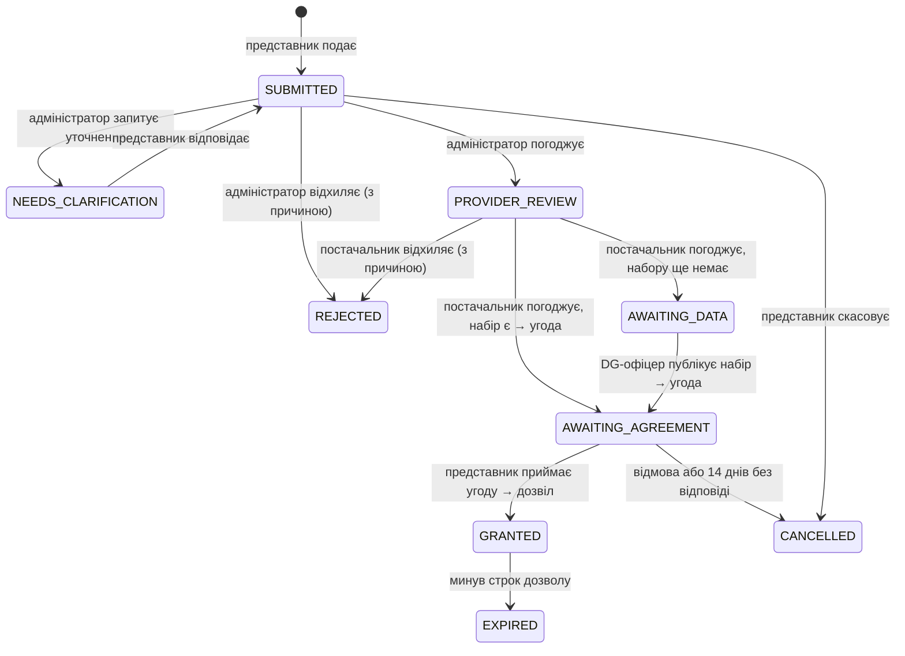

# 7. Обмін закритими даними: заявка → два погодження → угода → дозвіл → вивантаження

**Вимоги:** FR-11, FR-18 – FR-20, FR-24 – FR-28, FR-44, FR-45 · **Прецеденти:** UC-07 – UC-11, UC-16, UC-19 ·
**Правила:** D-01, D-03, DG-05, DG-07, DG-08, DG-11, DG-12 · **Рішення:** S-23 (чому два погодження), S-28, S-29.

**Код:** `backend/app/api/exchange.py` (заявки, рішення, угода, дозволи), `backend/app/core/access.py` (AccessPolicy),
`backend/app/core/agreement.py` (текст угоди), `backend/app/api/data.py` (перегляд і вивантаження),
`backend/app/api/jobs.py` (щоденне завершення дозволів), `.github/workflows/daily.yml`;
сторінки `frontend/src/pages/ExchangePages.tsx` («Заявки на дані», «Дозволи»).
**Тести:** `backend/tests/test_exchange.py` (6, з них один — увесь ланцюг від заявки до підтвердження видалення).

## Хто що робить
| Роль | Крок | Що перевіряє |
|---|---|---|
| Представник організації | подає заявку, відповідає на уточнення, приймає угоду, працює з даними, підтверджує видалення | — |
| Адміністратор | **перше погодження** | **хто й навіщо**: чи організація справжня, чи мета легітимна |
| Постачальник даних | **друге погодження** | **що й скільки**: який період, на який строк; може звузити |
| DG-офіцер | у ланцюгу заявки **не бере участі** — він раніше перевірив і опублікував сам набір | (файл 3) |

## Статуси заявки

## Крок 1. Заявка (`/requests` → `POST /api/access-requests`, UC-08)
Представник обирає країну, категорію, період даних, мету, місце використання, строк (1–180 днів) і відповідальну особу.
З каталогу можна перейти кнопкою «Подати заявку» — країна й категорія підставляться.

| № | Перевірка | Помилка |
|---|---|---|
| 1 | роль «Представник організації» | 403 `FORBIDDEN_ROLE` |
| 2 | організація заявника **верифікована** | 403 `ORGANIZATION_NOT_VERIFIED` (UC-08 EX1) |
| 3 | строк 1–180 днів (і обмеження CHECK у БД) | 422 |
| 4 | у країни є постачальник на платформі | 422 `NO_PROVIDER_FOR_COUNTRY` (UC-08 EX3) |
| 5 | за **завершеними** дозволами організації підтверджено видалення даних | 409 `DELETION_CONFIRMATION_REQUIRED` (DG-12, FR-45) |
| 6 | немає іншої **активної** заявки організації на ту саму країну × категорію | 409 `DUPLICATE_ACTIVE_REQUEST` + номер наявної (UC-08 EX2) |

Заявка отримує номер `GEDH-2026-0001`. Система шукає **опублікований** набір для «країна × категорія»;
якщо його немає — заявка все одно приймається як «запит на дані» (UC-08 AC1). Журнал `REQUEST_SUBMIT`, лист адміністраторам.

## Крок 2. Перше погодження — адміністратор (UC-09)
`POST /api/access-requests/{id}/admin-decision`:
- **погодити** → `PROVIDER_REVIEW`, лист постачальникам країни;
- **відхилити** — лише з причиною → `REJECTED`, лист заявнику;
- **запитати уточнення** — з питанням → `NEEDS_CLARIFICATION`; представник відповідає (`.../clarification`) → знову `SUBMITTED`.

**Заборонено** (D-01, DG-07): адміністратору — розглядати власну заявку **або заявку своєї організації** → 403
`SELF_REVIEW_FORBIDDEN`. Для заявника це додатково гарантує тригер БД. Рішення — запис в `approval_decisions`
(одне на етап — обмеження UNIQUE у БД), журнал `REQUEST_DECISION`.

## Крок 3. Друге погодження — постачальник (UC-10)
Постачальник бачить заявки на країну своєї організації **лише після** першого погодження (UC-10 EX2).
`POST /api/access-requests/{id}/provider-decision`:
- **погодити повністю**;
- **звузити**: період у межах запитаного і / або коротший строк. Розширити не можна → 422 `SCOPE_NOT_NARROWER`;
- **відхилити** з причиною.

Далі: набір опубліковано → система **одразу формує угоду** (`AWAITING_AGREEMENT`); набору немає → `AWAITING_DATA`.
У другому випадку постачальник завантажує набір (файл 3), і щойно DG-офіцер його публікує, угода формується
автоматично для всіх заявок, що чекали на ці дані (UC-13 крок 5).

## Крок 4. Угода (УОД, UC-11, DG-11)
Текст формується з **погодженого** обсягу (`backend/app/core/agreement.py`, версія тексту 1.0): сторони, набір,
країна, категорія, період, строк, мета, місце використання; обов'язки — не передавати третім особам, видалити
після строку й підтвердити (DG-12), зберігати позначку «СИНТЕТИЧНІ ДАНІ»; аудит кожного звернення; право DG-офіцера
призупинити доступ. Якщо обсяг звужено — це сказано в тексті (UC-11 AC1).

Зберігаються **повний текст і його SHA-256** (`data_sharing_agreements`). Пропозиція чинна **14 днів**.

## Крок 5. Акцепт і дозвіл
`POST /api/access-requests/{id}/agreement/accept` з **хешем показаного тексту**:
- хеш не збігся (текст змінився) → 409 `AGREEMENT_TEXT_CHANGED` — людина погоджується саме з тим, що бачила;
- минуло 14 днів → 409 `OFFER_EXPIRED`, заявка `CANCELLED`;
- інакше **в одній транзакції**: дата акцепту, **дозвіл** (`access_grants`): отримувач, набір, погоджений період,
  `valid_from` = зараз, `valid_to` = зараз + строк (CHECK у БД: ≤ 180 днів), статус `ACTIVE`; заявка `GRANTED`;
  журнал `AGREEMENT_ACCEPT` (з SHA-256 тексту) і `GRANT_ISSUE`; листи заявнику, постачальнику, адміністраторам.

## Крок 6. Доступ до даних — на кожному запиті (UC-16, AccessPolicy)
`backend/app/core/access.py`, функція `authorize()`:

| Хто | Рішення |
|---|---|
| відкритий набір | будь-який активний обліковий запис |
| DG-офіцер | дозволено за роллю (перевірка й контроль) |
| постачальник-власник | дозволено за роллю (свої набори) |
| усі інші | лише **чинний дозвіл**: той самий набір, `ACTIVE`, **`valid_from ≤ зараз < valid_to`**, період перетинається з запитаним |

- Видається **лише частина, яку покриває дозвіл**; якщо частину відрізано — `coverage: PARTIAL` (UC-16 AC1).
  Приклад: набір ВРП за 2019–2024, дозвіл на 2022–2024 → таблиця показує лише 2022–2024.
- Строк перевіряється на кожному зверненні: дозвіл перестає діяти **в момент закінчення строку**, навіть якщо щоденна
  задача ще не встигла позначити його завершеним (DG-05).
- Відмова: `ACCESS_DENIED` (дозволу немає), `GRANT_EXPIRED`, `GRANT_SUSPENDED` — 403 і запис `DENIED` у журнал (UC-16 EX2).

## Крок 7. Перегляд і вивантаження (UC-07, FR-11, FR-27)
Сторінка «Дозволи» → «Дані»: таблиця «показник · розріз × період», банер «СИНТЕТИЧНІ ДАНІ», межі дозволу.
- `GET /api/datasets/{id}/observations` — перегляд; журнал `DATA_VIEW` з ідентифікатором дозволу.
- `GET /api/datasets/{id}/export?format=csv|json` — файл:
  - **метадані:** набір, версія, дата публікації й формування, ліцензія, джерело, позначка синтетичних даних,
    **ідентифікатор дозволу**, покриття. У CSV — рядками `# ключ: значення` на початку; у JSON — об'єкт `metadata`;
  - **SHA-256 файлу** — у заголовку `X-Content-SHA256`, у таблиці `data_exports` і в журналі `DATA_DOWNLOAD`;
    дозвіл — у заголовку `X-Grant-Id`;
  - **захист від CSV injection:** текст, що починається з `= + - @`, отримує префікс `'` — Excel не виконає його як формулу;
  - UTF-8 з BOM, щоб Excel показав кирилицю.
- Відкриті дані вивантажуються так само (сторінка «Дані»), без дозволу.

## Крок 8. Завершення дозволу (UC-19, FR-28)
Щодня о 02:15 UTC GitHub Actions викликає `POST /api/internal/jobs/expire-grants` (секрет `X-Job-Token`):
- дозволи з минулим строком → `EXPIRED`, заявка → `EXPIRED`, журнал `GRANT_EXPIRE`, лист отримувачу:
  «видаліть дані й підтвердіть видалення» (DG-12);
- постачальники країни теж отримують сповіщення про завершення (UC-19 крок 4);
- пропозиції угод старші за 14 днів → заявка `CANCELLED` (UC-11 EX2);
- **за 7 днів до завершення** — одне нагадування отримувачу (UC-19 AC2; повторно не надсилається, файл 10).

### Призупинення DG-офіцером (UC-19 AC1, FR-38)
«Дозволи» → **«Призупинити»** біля чинного дозволу → причина (щонайменше 10 символів; без причини — 422, UC-19 EX1)
→ `POST /api/grants/{id}/suspend`:
- статус `SUSPENDED`, причина зберігається й показується всім, хто бачить дозвіл;
- **доступ закривається на наступному ж зверненні**: AccessPolicy → 403 `GRANT_SUSPENDED`;
- журнал `GRANT_SUSPEND` з причиною; сповіщення отримувачу (видаліть дані й підтвердіть), постачальникам країни
  й адміністраторам;
- **призупинення остаточне**: поновлення звіт не передбачає, доступ відновлюється лише новою заявкою (DG-08);
- адміністратор призупинити не може (403) — це рішення контролера (DG-07); повторно — 409 `INVALID_STATE`.

## Крок 9. Підтвердження видалення (DG-12, FR-44, FR-45)
На сторінці «Дозволи» біля завершеного **або призупиненого** дозволу — кнопка **«Підтвердити видалення даних»**
(`POST /api/grants/{id}/confirm-deletion`, журнал `DELETION_CONFIRM`). Поки цього не зроблено,
**нові заявки організації не приймаються**. Під час видалення облікового запису видалення підтверджується за всіма
дозволами одразу (файл 1, крок 9).

## Що записується в журнал аудиту за весь ланцюг
`REQUEST_SUBMIT` → `REQUEST_DECISION` (адміністратор) → `REQUEST_DECISION` (постачальник) → `DATASET_PUBLISH`
(якщо набір публікувався під заявку) → `AGREEMENT_ACCEPT` → `GRANT_ISSUE` → `DATA_VIEW` / `DATA_DOWNLOAD`
(кожне звернення, з дозволом і хешем файлу) → `GRANT_EXPIRE` або `GRANT_SUSPEND` → `DELETION_CONFIRM`.
Увесь ланцюг для набору видно на сторінці «Походження» (файл 9).
Кожен запис пов'язаний хешем із попереднім (файл 5).
