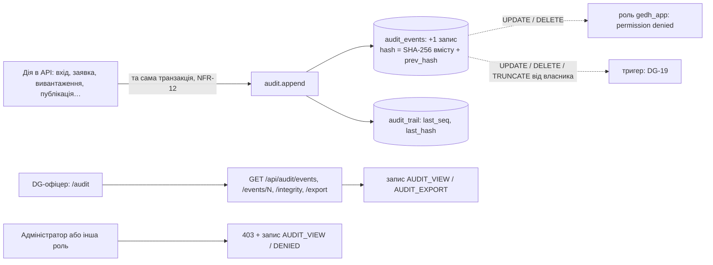

# 8. Журнал аудиту: запис подій, захист, перегляд DG-офіцером, строки зберігання

**Вимоги:** FR-30 (запис), FR-31 (перегляд із фільтрами), FR-32 (цілісність, Could), FR-40 (експорт CSV, Should),
FR-42 (анонімізація) · **Прецеденти:** UC-15, UC-17, UC-21 · **Правила:** D-38, D-40, DG-07, DG-17 – DG-19,
DG-23 – DG-25 · табл. 3.26 (строки зберігання), табл. 3.30 (структура запису), рис. 5.3 (пакет audit).

**Код:** `backend/app/core/audit.py` (запис і перевірка ланцюжка), `backend/app/api/audit.py` (перегляд),
`backend/app/api/jobs.py` (`apply_retention`), `backend/app/core/db.py` (роль застосунку),
`backend/alembic/versions/0006_audit_append_only.py` (захист у БД); сторінка `frontend/src/pages/AuditPage.tsx`.
**Тести:** `backend/tests/test_audit.py` (7).

## Ідея одним реченням
Кожна значуща дія людини чи системи додає в журнал запис із хешем попереднього запису. Змінити запис не дає
**база даних**, а якщо хтось обійде і її, **перевірка ланцюжка** вкаже перший змінений запис. Читає журнал лише
DG-офіцер, і кожен його перегляд теж потрапляє в журнал.

## Схема

## Крок 1. Запис події (`audit.append`)
Викликається **в тій самій транзакції**, що й основна дія. Якщо запис у журнал не вдався, скасовується все (NFR-12, UC-17 EX1).

1. `db.flush()` — спершу основні зміни;
2. `SELECT … FROM audit_trail WHERE id = 1 FOR UPDATE` — блокується «голова» ланцюжка, тож дві одночасні дії
   не отримають однаковий номер і не розгалужать ланцюжок (D-40). Блокування береться безпосередньо перед
   фіксацією транзакції, тому триває мілісекунди;
3. новий запис: `seq = last_seq + 1`, `prev_hash = last_hash`, `hash = SHA-256(вміст у JSON з відсортованими ключами + prev_hash)`;
4. `audit_trail` отримує новий номер і хеш.

**Відмови (DG-06, S-38).** Кожна 403 автентифікованого користувача потрапляє в журнал: відмови за роллю й за дозволом
пишуть самі перевірки, а решту — «чужа заявка», «власна заявка» (D-01), «неверифікована організація», «чужий набір» —
обробник помилок `app/core/errors.py` як `SECURITY_INCIDENT / DENIED` з кодом причини. Дублів немає.

**Що в записі** (табл. 3.30): номер, час UTC, ідентифікатор і роль виконавця, організація, дія, об'єкт (тип + ідентифікатор),
результат (`SUCCESS` / `DENIED` / `ERROR`), ідентифікатор запиту, деталі JSON, `prev_hash`, `hash`.
**Чого немає:** ПІБ, e-mail, IP-адрес і значень закритих даних (D-40, DG-25). Тому анонімізація облікового запису
не змінює журналу й не ламає ланцюжка.

## Крок 2. Захист у базі даних (міграція 0006, S-30)
| Рівень | Як працює | Що станеться при спробі змінити запис |
|---|---|---|
| **Роль застосунку `gedh_app`** | застосунок на початку кожної транзакції виконує `SET LOCAL ROLE gedh_app`; у ролі на `audit_events` лише SELECT і INSERT, на `audit_trail` — без DELETE | `permission denied for table audit_events` |
| **Тригери** | `audit_events`: заборона UPDATE / DELETE / TRUNCATE для **будь-якої** ролі; `audit_trail`: не можна видалити, номер лише зростає | `DG-19: журнал аудиту лише доповнюється (UPDATE заборонено)` — навіть від власника БД у консолі Neon |
| **Хеш-ланцюжок** | якщо власник вимкне тригер і змінить запис | перевірка цілісності вкаже номер першого зміненого запису |

Перевірити, що роль діє на живому сайті: `/api/health` → `db.app_role` має бути `gedh_app`.

## Крок 3. Перегляд журналу (`/audit`, лише DG-офіцер)
| Дія на сторінці | Запит | Що відбувається | Запис у журнал |
|---|---|---|---|
| відкрити сторінку, «Показати» | `GET /api/audit/events?…&limit=50` | 50 найновіших записів за фільтрами | `AUDIT_VIEW`, у деталях — фільтри (e-mail замінено на ідентифікатор) і кількість |
| «Показати старіші» | той самий запит з `before_seq=N` | наступні 50 | `AUDIT_VIEW` |
| «Деталі» | `GET /api/audit/events/{seq}` | деталі JSON, обидва хеші, **`hash_valid`**: хеш відповідає вмісту й попередньому запису | `AUDIT_VIEW` (номер запису) |
| «Перевірити цілісність журналу» | `GET /api/audit/integrity` | перерахунок усіх хешів від першого запису: «цілісність підтверджено: перевірено N записів» або «ланцюжок порушено, починаючи із запису № N» | `AUDIT_VIEW` (результат) |
| «Експорт вибірки в CSV» | `GET /api/audit/export?…` | до 10 000 записів за тими ж фільтрами; UTF-8 з BOM; захист від CSV injection; **без e-mail** | `AUDIT_EXPORT`: фільтри, кількість, SHA-256 файлу (він же в заголовку `X-Content-SHA256`) |

**Фільтри (UC-15 крок 2):**
| Фільтр | Параметр | Як працює |
|---|---|---|
| користувач | `actor_email` (або `actor_id`) | e-mail перетворюється на ідентифікатор; немає такого — порожній список |
| організація | `organization_id` | організація, від імені якої діяли |
| країна | `country` | об'єкт події належить країні: закритий набір і його версії, дозволи, заявки й угоди на цю країну, організація чи користувач з цієї країни; **або** виконавець діяв від організації цієї країни |
| набір | `dataset_id` | сам набір, його версії, запуски імпорту, дозволи, заявки й угоди на нього |
| тип дії, результат | `action`, `result` | перелік AuditAction (рис. 5.8) — українською на сторінці |
| період | `from`, `to` | дата на сторінці → межі доби за UTC |

**Що бачить DG-офіцер у таблиці:** номер, час, виконавець (поточний e-mail з довідника; «система» — для задач за розкладом;
«невідомий e-mail» — для невдалого входу з адресою, якої немає в системі; «анонімізовано» — після анонімізації), роль,
організація, дія, об'єкт, результат. Рядки з відмовами виділено.

**Інші ролі, зокрема адміністратор** (UC-15 EX1, D-38, DG-07): будь-який маршрут `/api/audit/*` → **403 `FORBIDDEN_ROLE`**,
а спроба записується як `AUDIT_VIEW / DENIED` з маршрутом в об'єкті. Пункту меню «Журнал аудиту» в них немає.

## Крок 4. Строки зберігання й анонімізація (`POST /api/internal/jobs/retention`)
Щодня після 03:00 UTC у складі задачі дня `daily` (S-40: сервер запускає її сам з першим запитом; `daily.yml` — лише будильник),
після завершення дозволів. Там само — резервна копія БД (файл 12).
Захищено `X-Job-Token`, як і інші службові задачі. Ідемпотентно: повторний запуск нічого не змінює.

| Категорія (табл. 3.26) | Умова | Що робиться |
|---|---|---|
| облікові записи | деактивовано понад 30 днів тому; відхилена реєстрація понад 30 днів тому; e-mail не підтверджено 30 днів | **анонімізація** (DG-24): ПІБ → «Анонімізований користувач», e-mail → `anonymized-<id>@anonymized.invalid`, посада, мета реєстрації й листування — стерто; пароль недійсний; сесії, токени, API-ключі видалено; статус `ANONYMIZED` |
| документи верифікації | 30 днів після рішення адміністратора (`delete_after`) | файл видаляється |
| відхилені файли карантину | 30 днів після відхилення | файл видаляється |
| сирі відповіді API | 90 днів | видаляються; SHA-256 лишається в запуску імпорту |
| токени дій, сесії | використані або прострочені понад 30 днів тому | видаляються |
| записи згоди | 3 роки після закриття облікового запису | **не видаляються** (T-08); змінити їх не дає тригер DG-10 |
| журнал аудиту, заявки, дозволи | 3 роки | **не видаляються** (T-08, DG-19) |

**У журнал:** для кожної непорожньої категорії — `RETENTION_PURGE` з назвою й кількістю (DG-23); для кожного анонімізованого
облікового запису — `ACCOUNT_DELETE` з `step: ANONYMIZED`. Записи журналу про цю людину лишаються, але її ідентифікатор
більше ні з ким не пов'язаний — це псевдонім.

## Коди помилок
| Код | Коли |
|---|---|
| 401 `NOT_AUTHENTICATED` | без входу |
| 403 `FORBIDDEN_ROLE` | будь-яка роль, крім DG-офіцера |
| 404 `NOT_FOUND` | немає запису з таким номером |
| 422 | неправильний фільтр (наприклад, країна не трьома великими літерами) |
| 401 `JOB_TOKEN_INVALID` | службова задача без правильного токена |

## Тести (`backend/tests/test_audit.py`)
| Тест | Що перевіряє |
|---|---|
| `test_only_dg_officer_sees_the_log_and_attempts_are_recorded` | адміністратор, аналітик, постачальник → 403 на всі 4 маршрути; кожна спроба — `AUDIT_VIEW / DENIED` |
| `test_list_filters_pagination_and_view_is_logged` | фільтр за e-mail і результатом, `before_seq`, порожній результат, «невідомий e-mail»; перегляд записано без e-mail |
| `test_filter_by_dataset_and_country` | події набору; відмова аналітику видна за країною набору й не видна за іншою; фільтр за організацією |
| `test_event_detail_integrity_and_export` | `hash_valid`, 404, цілісність, CSV: хеш заголовка = хеш файлу = хеш у журналі, e-mail у файлі немає |
| `test_integrity_check_finds_the_first_tampered_record` | вимкнути тригер і змінити запис (у транзакції, яку потім скасовано) → перевірка повертає саме цей номер |
| `test_database_forbids_changing_the_log` | роль застосунку — `permission denied`; власник — помилка тригера; номер ланцюжка не зменшується; додавання працює |
| `test_retention_anonymizes_after_30_days_and_purges_files` | 31 день → анонімізовано, 5 днів → ні; файл з минулим строком видалено; журнал і ланцюжок цілі; вхід неможливий; повторний запуск нічого не змінює |
