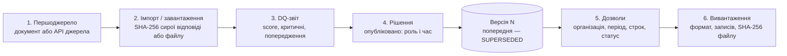

# 9. Походження набору (lineage): звідки взялося значення і куди воно пішло

**Вимоги:** FR-33 (Should) · **Прецеденти:** UC-05 крок 6, UC-15 AC2 · **Правила:** DG-16 (ланцюжок для кожної версії),
DG-05 (доступ лише за дозволом), D-05 (версії не перезаписуються).

**Код:** `backend/app/api/data.py` → `lineage()`, `source_info()`; сторінка `frontend/src/pages/LineagePage.tsx`.
**Тести:** `backend/tests/test_e6a.py::test_lineage_scope_by_role`.

## Ідея одним реченням
Для будь-якої версії набору можна показати весь шлях **«першоджерело → імпорт або завантаження → перевірка якості →
рішення про публікацію → дозволи → вивантаження»** — і на кожному кроці є хеш, за яким це можна перевірити.

## Схема (DG-16)

## Як відкрити
- **Каталог** → «Походження» біля будь-якого набору (для тих, хто увійшов);
- **«Дозволи»** → «Походження» біля дозволу (DG-офіцер, адміністратор, постачальник);
- **«Журнал аудиту»** → фільтр «Набір даних» → «Походження цього набору».

Запит: `GET /api/datasets/{id}/lineage`.

## Хто що бачить
| Хто | Відкритий набір | Закритий набір |
|---|---|---|
| будь-який активний користувач | весь ланцюжок версій; свої вивантаження | **403 `ACCESS_DENIED`** і запис `DATA_VIEW / DENIED` (view = lineage) |
| отримувач із чинним дозволом | — | ланцюжок версій, **лише свої** дозволи й вивантаження (`scope: own`) |
| **DG-офіцер**, **постачальник-власник** | усе | **усе**: дозволи й вивантаження всіх організацій (`scope: all`) |

Чужі дозволи бачать лише контролер і власник даних — так отримувачі не дізнаються, хто ще працює з тими самими даними.

## Що показується для кожної версії
| Крок DG-16 | Поле | Відкритий набір | Закритий набір |
|---|---|---|---|
| 1. першоджерело | `source` | ряд джерела (напр. «World Bank — WDI (NY.GDP.MKTP.CD)»), адреса запиту до API | документ, номер, дата, посилання, методика, відповідальна особа |
| 2. хеш сирих даних | `source.raw_sha256` / `file_sha256` | SHA-256 відповіді API | SHA-256 завантаженого файлу |
| 3. DQ-звіт | `quality` | score, записів, критичних, попереджень | те саме + коли постачальник підтвердив попередження |
| 4. рішення | `published_at`, `published_by_role` / `rejection_reason` | конектор (система) | DG-офіцер; або причина відхилення |
| — | `previous_version_no` | яку версію замінила | те саме |
| 5. дозволи | `grants` (на рівні набору) | — | організація, період, строк, статус, причина призупинення, коли підтверджено видалення |
| 6. вивантаження | `exports` | час, формат, записів, SHA-256 файлу | те саме + чи за дозволом і від якої організації |

**Не показується:** ПІБ і e-mail людей — лише роль (D-40); значення даних — лише метадані.

## Журнал аудиту
Кожен перегляд походження — `DATA_VIEW` з `view: lineage`, кількістю версій і обсягом (`all` / `own`).

## Обмеження
Ланцюжок показується для набору цілком (усі версії), а не для окремого значення, як сформульовано в UC-05 крок 6.
Значення завжди належить одній версії, тож його походження — це рядок відповідної версії.
