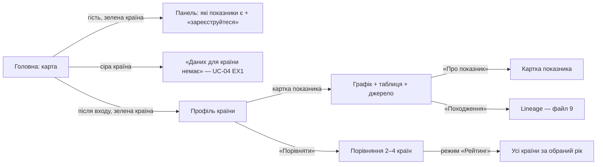

# 11. Аналітика: карта покриття, профіль країни, порівняння, рейтинг, картка показника

**Вимоги:** FR-06, FR-07 (карта), FR-08 (профіль), FR-09 (картка показника), FR-10 (порівняння), FR-36 (рейтинг, Could) ·
**Прецеденти:** UC-04, UC-05, UC-06 · **Правила:** DG-13 (метадані каталогу), DG-04 (закриті — лише за заявкою).

**Код:** `backend/app/api/analytics.py` (профіль, картка), `backend/app/api/data.py` → `coverage()`;
`frontend/src/pages/AnalyticsPages.tsx`, `frontend/src/components/WorldMap.tsx`, `LineChart.tsx`, `frontend/src/lib/geo.ts`.
**Тести:** `backend/tests/test_e6b.py` (4).

## Ідея одним реченням
Усе тут — **лише відкриті дані** World Bank, IMF і BIS. Гість бачить, **для яких країн і які показники** є, але без значень;
після входу — значення, графіки, порівняння й рейтинг. Закриті набори видно лише як перелік «доступ за заявкою».

## Маршрут користувача

## Крок 1. Карта покриття (головна, UC-04, FR-06, FR-07)
- `GET /api/coverage` — **публічно, без значень і без журналу**: для кожної країни кількість і коди показників, що мають дані.
- Контури країн — Natural Earth 1:110m (пакет `world-atlas`, ISC; дані Natural Earth — Public Domain); завантажуються окремим файлом
  (~40 КБ стиснуто), лише коли відкрито головну. Числовий код ISO контуру ↔ код платформи — `lib/geo.ts`.
- **Зелені** — 25 країн платформи, для яких є хоча б одне значення; **сірі** — решта.
- Наведення курсора — підсвічування й підказка «назва · N показників» (UC-04 крок 3).
- Натискання:
  - **гість, зелена країна** — панель із переліком показників (одиниця, частота, посилання на картку) і пропозицією
    зареєструватися (UC-04 крок 5);
  - **користувач після входу** — профіль країни;
  - **сіра країна** — «даних для країни немає» (EX1).

## Крок 2. Профіль країни (`/countries/{код}`, UC-05, FR-08)
`GET /api/countries/{код}/profile` — лише після входу; **один агрегований запит** до спостережень чинних опублікованих
версій відкритих наборів (NFR-02).

| На сторінці | Звідки |
|---|---|
| **картки** всіх показників: останнє значення з одиницею, рік, **▲/▼ зміна до попереднього року**; `*` — є примітка (оцінка IMF, ставка ЄЦБ) | `latest`, `previous`, `change` |
| обраний показник: **графік** ряду, вибір періоду «з — до» | `series` |
| **таблиця** значень (нові зверху); пропуск — «н/д», **без інтерполяції** (UC-05 EX1) — на графіку розрив лінії | `series` |
| **джерело**, дата оновлення, **версія**, ліцензія; посилання «Про показник» і «Походження» | `source`, `published_at`, `version_no` |
| **закриті набори країни**: назва, постачальник, «СИНТЕТИЧНІ ДАНІ», «доступ за заявкою»; представнику — «Подати заявку» (UC-05 AC2) | `restricted` — лише опис |

**Журнал:** `DATA_VIEW`, object_type `country`, object_id — код країни, `view: country_profile` (постумова UC-05).
DG-офіцер знаходить ці перегляди фільтром «Країна» в журналі аудиту.

## Крок 3. Порівняння й рейтинг (`/compare`, UC-06, FR-10, FR-36)
Окремих маршрутів API немає — сторінка використовує `GET /api/datasets/{id}/observations` (перевірка доступу й журнал — як
для будь-якого перегляду даних, файл 2).

- **Графік:** показник + **від 1 до 4 країн** (`?countries=UKR,POL,…`) + період. Спроба додати п'яту — пояснення ліміту
  (UC-06 EX1). Однакові одиниці гарантує сам показник. Наведення — значення всіх країн за рік.
- **Рейтинг** (UC-06 AC1): усі країни з даними за обраний рік, упорядковані за значенням; від'ємні — червоним;
  обрані в порівнянні країни виділено; назва веде до профілю.
- Стан сторінки — в адресі (`?indicator=…&countries=…&mode=rank&year=…`), тож посиланням можна поділитися.

## Крок 4. Картка показника (`/indicators/{код}`, FR-09)
`GET /api/indicators/{код}` — **публічно, без значень**: код, назва UA / EN, визначення, одиниця й масштаб, частота, джерело,
класифікація (відкриті / закриті — за заявкою), ліцензія, набори з цим показником і **покриття країн** (роки від — до).
Відкривається з каталогу (назва показника), з профілю й порівняння («Про показник»), з панелі гостя на карті.

## Чого тут немає і чому
- **Закритих значень** — лише через заявку й дозвіл (файл 7); профіль показує тільки їх перелік.
- **Інтерполяції** — пропуск лишається пропуском (UC-05 EX1).
- **Графіки — власний SVG** (`LineChart.tsx`) без бібліотек: менший розмір і повний контроль над виглядом на етапі дизайну.
